<div align="center">

<a href="https://portfolio-emsghin2iq-as.a.run.app">
  <picture>
    <source media="(prefers-color-scheme: dark)" srcset="https://capsule-render.vercel.app/api?type=waving&height=210&color=0:0d1117%2C100:1a2e05&text=Li%20ZhenXi&fontColor=c2f75c&fontSize=58&fontAlignY=36&desc=SRE%20%C2%B7%20Cloud%20%C2%B7%20AI%20infrastructure&descSize=18&descAlignY=58&section=header" />
    <source media="(prefers-color-scheme: light)" srcset="https://capsule-render.vercel.app/api?type=waving&height=210&color=0:ffffff%2C100:d9f99d&text=Li%20ZhenXi&fontColor=365314&fontSize=58&fontAlignY=36&desc=SRE%20%C2%B7%20Cloud%20%C2%B7%20AI%20infrastructure&descSize=18&descAlignY=58&section=header" />
    
  </picture>
</a>

<picture>
  <source media="(prefers-color-scheme: dark)" srcset="https://readme-typing-svg.demolab.com?font=JetBrains+Mono&weight=500&size=17&pause=1600&color=C2F75C&center=true&vCenter=true&width=640&lines=I+run+Kubernetes+in+production+on+Google+Cloud;Portfolio%3A+99.99%25+up+since+19+Oct%2C+63+deploys+in+30+days;I+benchmark+LLM+agents+on+A100+GPUs;Just+merged%3A+hyscale-lab%2FARIES%2392;Open+an+issue+titled+ask%3A+%E2%80%A6+and+my+site+replies" />
  <source media="(prefers-color-scheme: light)" srcset="https://readme-typing-svg.demolab.com?font=JetBrains+Mono&weight=500&size=17&pause=1600&color=3F6212&center=true&vCenter=true&width=640&lines=I+run+Kubernetes+in+production+on+Google+Cloud;Portfolio%3A+99.99%25+up+since+19+Oct%2C+63+deploys+in+30+days;I+benchmark+LLM+agents+on+A100+GPUs;Just+merged%3A+hyscale-lab%2FARIES%2392;Open+an+issue+titled+ask%3A+%E2%80%A6+and+my+site+replies" />
  
</picture>

DevOps intern at Primustech · Computer Science at NTU, graduating June 2027 · [ICCV 2025 co-author](https://portfolio-emsghin2iq-as.a.run.app/research)<br>
**Open to 2027 roles in SRE, cloud and AI infrastructure.**

<a href="https://portfolio-emsghin2iq-as.a.run.app"></a>
<a href="https://www.linkedin.com/in/zhenxi-li-lzx391/"></a>
<a href="mailto:zli057@e.ntu.edu.sg"></a>

<a href="https://github.com/zhenxi0901/portfolio/actions/workflows/deploy.yml"></a>
<a href="https://portfolio-emsghin2iq-as.a.run.app/status"></a>
<a href="https://github.com/zhenxi0901/portfolio/actions/workflows/ci.yml"></a>
<a href="https://github.com/zhenxi0901/portfolio/actions/workflows/deploy.yml"></a>

</div>

## What I work on

**Building IoT platform** · <sub>Primustech</sub><br>
Live data from building systems (sensors, HVAC, meters), with the dashboards and alarms facility teams use, on GKE. **169 of my PRs merged.** I moved it from one VM to GKE microservices with Terraform, own its Cloud Build CI/CD, cut its cloud spend by an estimated ~15%, built its Grafana dashboards and alerts, and wrote the safety pattern its remote-control lanes are measured against (431 tests on the control bridge). Security and reliability changes go out in steps that can each be undone.<br>
<sub>Case studies: [GKE migration](https://portfolio-emsghin2iq-as.a.run.app/work/gke) · [delivery pipeline](https://portfolio-emsghin2iq-as.a.run.app/work/pipeline) · [cost cut](https://portfolio-emsghin2iq-as.a.run.app/work/reaper) · [alerting](https://portfolio-emsghin2iq-as.a.run.app/work/observability) · [remote control that fails safe](https://portfolio-emsghin2iq-as.a.run.app/work/control) · [changes in reversible steps](https://portfolio-emsghin2iq-as.a.run.app/work/two-step) · [the platform up close](https://portfolio-emsghin2iq-as.a.run.app/iot)</sub>

**AI agent platform** · <sub>Primustech</sub><br>
Two agents for facility teams, one answering from live building data and one from company documents (RAG), on Cloud Run and Vertex AI. **3 environments, deployed the same way.** I deploy and run the agent and RAG services in dev, staging and production: per-environment CI/CD, IAM, secrets and shared-VPC networking, with latency, token-cost and model benchmarks.<br>
<sub>[Case study](https://portfolio-emsghin2iq-as.a.run.app/work/ai-platform) · [the platform up close](https://portfolio-emsghin2iq-as.a.run.app/ai)</sub>

**ARIES agent benchmarks** · <sub>NTU HyScale Lab, final-year project</sub><br>
Long-horizon LLM agent workloads on the lab's open-source agent-serving framework. **320 agent runs benchmarked; 6,678 lines merged upstream.** The Toolathlon adapter for ARIES, and an Apptainer backend so the whole stack runs on a supercomputer without Docker or root. The runs used a hosted API and self-hosted SGLang on an A100; 48 more were instrumented to see what each MCP tool server costs per call.<br>
<sub>[Findings](https://portfolio-emsghin2iq-as.a.run.app/research) · [running it without root](https://portfolio-emsghin2iq-as.a.run.app/writing/agents-without-root) · [ARIES](https://github.com/hyscale-lab/ARIES)</sub>

**Robot car** · <sub>NTU Multidisciplinary Design Project, Aug to Oct 2026</sub><br>
An autonomous car: an STM32 drives it, a Raspberry Pi links it to the tablet, and a laptop plans the route and recognises targets in the Pi's camera feed. **21 merged PRs.** The Android tablet controller, in Kotlin: I made the tablet and the Pi agree on the map, and removed a planning state the app could never leave.<br>
<sub>[Repository](https://github.com/whupdido/mdp)</sub>

## In numbers

- **~15%** lower cloud spend, as estimated in my cost review (the work itself is private): 914 orphaned Kafka topics reaped, monitoring samples cut 40%, Cloud SQL and pods right-sized.
- **320** LLM agent runs benchmarked: MCP tool calls are 2.7% of agent time, and 96% of input tokens come from the prefix cache.
- **~7x**: serving jobs held the A100 about seven times longer than the agents used it.
- **3.02x** throughput from four isolated agent tasks at once on one VM.
- **10** principles for remote control of building equipment, each traced to the finding behind it, and **431** tests on the bridge that applies them.
- **6,678** lines across 46 files: the Apptainer backend that runs ARIES on a supercomputer without root, merged upstream.

## See it running

My [portfolio](https://portfolio-emsghin2iq-as.a.run.app) is a small production service in its own right: a Go API on Cloud Run with its own 99.9% SLO, measured from outside by uptime checks and shown live on its status page; DORA metrics computed from its own deploy history; OpenTelemetry traces in Cloud Trace, with each [Ask](https://portfolio-emsghin2iq-as.a.run.app/about#ask) answer showing its own; and a pipeline that builds the image once, tests and signs it, checks it before it takes traffic and rolls it back on its own if the live checks fail. The map and the card below are drawn live by the portfolio's own Go server, with its own numbers:

<a href="https://portfolio-emsghin2iq-as.a.run.app/status">
<picture>
  <source media="(prefers-color-scheme: dark)" srcset="https://portfolio-emsghin2iq-as.a.run.app/api/map.svg" />
  <source media="(prefers-color-scheme: light)" srcset="https://portfolio-emsghin2iq-as.a.run.app/api/map.svg?theme=light" />
  
</picture>
</a>

<a href="https://portfolio-emsghin2iq-as.a.run.app/status">
  <picture>
    <source media="(prefers-color-scheme: dark)" srcset="https://portfolio-emsghin2iq-as.a.run.app/api/card.svg" />
    <source media="(prefers-color-scheme: light)" srcset="https://portfolio-emsghin2iq-as.a.run.app/api/card.svg?theme=light" />
    
  </picture>
</a>

**Chapters:** [Building IoT platform](https://portfolio-emsghin2iq-as.a.run.app/iot) · [AI agent platform](https://portfolio-emsghin2iq-as.a.run.app/ai) · [Research](https://portfolio-emsghin2iq-as.a.run.app/research) · [Writing and postmortems](https://portfolio-emsghin2iq-as.a.run.app/writing) · [About me](https://portfolio-emsghin2iq-as.a.run.app/about)

[Status](https://portfolio-emsghin2iq-as.a.run.app/status) · [Changelog](https://portfolio-emsghin2iq-as.a.run.app/changelog) · [Why it's built this way](https://portfolio-emsghin2iq-as.a.run.app/decisions) · [For agents](https://portfolio-emsghin2iq-as.a.run.app/agents) · [Evidence for the claims](https://portfolio-emsghin2iq-as.a.run.app/evidence) · [Take the 60-second tour](https://portfolio-emsghin2iq-as.a.run.app/?tour)

### Try it yourself

- **[Debug the real server in a Codespace](https://codespaces.new/zhenxi0901/portfolio?ref=drill/01&quickstart=1)**: a branch of my portfolio with one bug planted in it. `make drill` shows the symptoms, `make check` grades your fix.
- **[Break it yourself](https://portfolio-emsghin2iq-as.a.run.app/break)**: inject delays and 503s into your own requests to the live server, and watch retries, a circuit breaker and hedging cope, attempt by attempt.
- **[What it costs](https://portfolio-emsghin2iq-as.a.run.app/cost)**: this month's bill, metered request by request, where the money goes, and what a traffic spike would do to it.
- **[Size a GPU for agents](https://portfolio-emsghin2iq-as.a.run.app/research#capacity)**: KV cache, decode speed and cost per agent task, starting from my FYP's measurements.
- **[Watch a real deploy](https://portfolio-emsghin2iq-as.a.run.app/status#replay)**: my site's latest release replayed step by step at its real timings: the provenance check, the error-budget gate, a new revision with no traffic, smoke tests, the traffic switch, and the rollback it didn't need.
- **[dora-card](https://github.com/zhenxi0901/dora-card)**: the four DORA metrics from my pipeline, extracted into a GitHub Action any repository can use for a README card.

### Ask it with your own agent

The portfolio is also a [Model Context Protocol](https://modelcontextprotocol.io) server: five read-only tools over its own facts and live numbers, with no key and no model on my side. Add it to Claude Code, or give the URL to any MCP client:

```sh
claude mcp add --transport http zhenxi https://portfolio-emsghin2iq-as.a.run.app/mcp
```

Then ask your agent what I worked on, or whether the site is inside its error budget. No agent to hand? The site has [a terminal of its own](https://portfolio-emsghin2iq-as.a.run.app/?terminal), a shell in the page over the same live API, and it answers a real one in text:

```sh
curl https://portfolio-emsghin2iq-as.a.run.app
```

<picture>
  <source media="(prefers-color-scheme: dark)" srcset="https://raw.githubusercontent.com/zhenxi0901/zhenxi0901/animations/terminal-dark.svg" />
  <source media="(prefers-color-scheme: light)" srcset="https://raw.githubusercontent.com/zhenxi0901/zhenxi0901/animations/terminal-light.svg" />
  
</picture>

Or ask right here on GitHub: [open an issue titled `ask: …`](https://github.com/zhenxi0901/zhenxi0901/issues/new?template=ask.yml) and my site answers it within a minute, from its own facts, then closes it.

[How to connect, and a console that sends real requests](https://portfolio-emsghin2iq-as.a.run.app/agents) · [`llms.txt`](https://portfolio-emsghin2iq-as.a.run.app/llms.txt)

## Postmortems

Blameless write-ups of what went wrong while I built and ran my portfolio: timeline, root cause, detection and action items linked to the commits that fixed them. Or take the other seat: [go on call](https://portfolio-emsghin2iq-as.a.run.app/oncall) for a simulated incident on either platform, or type `oncall` in [the site's terminal](https://portfolio-emsghin2iq-as.a.run.app/?terminal) to work it as text, and get a postmortem of your own response.

| Postmortem | What happened | The lesson |
|---|---|---|
| [“Message sent” for messages nobody would read](https://portfolio-emsghin2iq-as.a.run.app/postmortems/contact-form)<br><sub>Near miss · 0 messages lost</sub> | For 3 h 32 min the contact form said "sent" while keeping messages on a disk Cloud Run throws away. | Only say "done" after the durable handoff. |
| [The health check that only worked from inside](https://portfolio-emsghin2iq-as.a.run.app/postmortems/healthz)<br><sub>Near miss · caught before launch</sub> | Cloud Run's front end answers some paths ending in "z" itself, so `/healthz` was a 404 from outside while the app was healthy. | Test through the same front door your users use. |
| [A failing check on a healthy site](https://portfolio-emsghin2iq-as.a.run.app/postmortems/smoke-test)<br><sub>False alarm</sub> | The smoke test reported `/metrics` as broken while every request in the logs returned 200. | A flaky check is a broken check. |

## Writing

- [Running an agent benchmark on a supercomputer, without root](https://portfolio-emsghin2iq-as.a.run.app/writing/agents-without-root): a supercomputer gives users neither Docker nor root, so I added an Apptainer backend to ARIES, a way to measure containers that have no cgroup, and found one hang that looked like the agent's fault.
- [What 320 agent runs taught me about serving LLM agents](https://portfolio-emsghin2iq-as.a.run.app/writing/serving-llm-agents): MCP tool calls were 2.7% of agent time, 96% of input tokens came from the prefix cache, and the GPU sat idle most of the time it was held.
- [Finding a metrics bill in 914 orphaned Kafka topics](https://portfolio-emsghin2iq-as.a.run.app/writing/metrics-bill-kafka-topics): attribution first, a reaper that has to be a CronJob because the topics grow back, and dropping metrics only after checking who reads them.

## Open source

### In review

<!-- open-prs:start -->
- **[hyscale-lab/ARIES#104](https://github.com/hyscale-lab/ARIES/pull/104)** feat: add aries cleanup for what a crashed run left <sub>opened 2026-11-11</sub>
- **[hyscale-lab/ARIES#96](https://github.com/hyscale-lab/ARIES/pull/96)** feat: portable plugins (skills and MCP servers) for OpenClaw and Hermes <sub>opened 2026-11-02</sub>
<!-- open-prs:end -->

### Merged

<!-- merged-prs:start -->
- **[hyscale-lab/ARIES](https://github.com/hyscale-lab/ARIES)**: 4 merged
  - [#92](https://github.com/hyscale-lab/ARIES/pull/92) Add an Apptainer deployment backend <sub>merged 2026-11-10</sub>
  - [#55](https://github.com/hyscale-lab/ARIES/pull/55) feat(benchmark): add the Toolathlon adapter <sub>merged 2026-10-12</sub>
  - [#61](https://github.com/hyscale-lab/ARIES/pull/61) fix: wait for a Docker exec that has not started yet <sub>merged 2026-10-01</sub>
- **[whupdido/mdp](https://github.com/whupdido/mdp)**: 21 merged
  - [#44](https://github.com/whupdido/mdp/pull/44) Task 2: keep board telemetry out of Status; say when the board will look again <sub>merged 2026-10-13</sub>
  - [#43](https://github.com/whupdido/mdp/pull/43) Use the firmware's 07-Oct turn radii in the Android README and animation <sub>merged 2026-10-11</sub>
- **[maeganliew/LTU_VIE](https://github.com/maeganliew/LTU_VIE)**: 14 merged
  - [#17](https://github.com/maeganliew/LTU_VIE/pull/17) docs: update README with setup guide and project explanation <sub>merged 2026-05-22</sub>
  - [#16](https://github.com/maeganliew/LTU_VIE/pull/16) feat: add config-driven maps and themes <sub>merged 2026-05-21</sub>
<!-- merged-prs:end -->

## My portfolio's latest deploys

Every push to `main` runs lint, tests, a container smoke test, Lighthouse budgets and a CVE gate on one image, which CI then signs with an SBOM and build provenance. The deploy verifies those, holds the release if the error budget is spent, smoke-tests the new revision before it takes traffic and rolls back on its own if the live checks fail. Each release is a [GitHub release](https://github.com/zhenxi0901/portfolio/releases); the full history is in the [changelog](https://portfolio-emsghin2iq-as.a.run.app/changelog). Refreshed a few times a day.

<details>
<summary>The last five deploys</summary>

<!-- deploys:start -->
| Commit | Result | Started (UTC) | Took |
|---|---|---|---|
| [`76637b5`](https://github.com/zhenxi0901/portfolio/commit/76637b5cc1ca276d9a88eaae51261b9d3e590424) The ~15% cloud saving is an estimate, and the site says so | [passed](https://github.com/zhenxi0901/portfolio/actions/runs/43401060872) | 2026-11-13 09:24 | 1m 46s |
| [`9efe054`](https://github.com/zhenxi0901/portfolio/commit/9efe054e2c28a46285716205d372cc9da00317de) Third review: a fair comparison, steady pages, figures that name their runs | [passed](https://github.com/zhenxi0901/portfolio/actions/runs/43380655690) | 2026-11-13 06:43 | 2m 41s |
| [`1fd06df`](https://github.com/zhenxi0901/portfolio/commit/1fd06df510df17446064a2ca673463d78a008390) Second full review: one way to print money and uptime, sturdier reads, honest la | [passed](https://github.com/zhenxi0901/portfolio/actions/runs/43375203648) | 2026-11-13 05:55 | 1m 54s |
| [`79f06d1`](https://github.com/zhenxi0901/portfolio/commit/79f06d1409fcfb5a18e8a9aa717d434c756f1a92) Map: the latency belongs to the Go server, not to /api | [passed](https://github.com/zhenxi0901/portfolio/actions/runs/43364984500) | 2026-11-13 04:21 | 1m 53s |
| [`cd58821`](https://github.com/zhenxi0901/portfolio/commit/cd588217b0ef580a70f3ce378acdedec599a7a8c) /api/map.svg: the request path, live, for the GitHub profile | [passed](https://github.com/zhenxi0901/portfolio/actions/runs/43363751957) | 2026-11-13 04:10 | 1m 43s |
<!-- deploys:end -->

</details>

## Stack

- **Cloud and infrastructure:** Google Cloud (GKE, Cloud Run, Cloud Build, Vertex AI), AWS, Kubernetes, Docker, Terraform, Linux
- **Delivery and reliability:** GitHub Actions, Git, Prometheus, Grafana, OpenTelemetry
- **Languages:** Go, Python, Java, Kotlin, Bash, TypeScript
- **Data and messaging:** Kafka, Redis, PostgreSQL
- **AI infrastructure:** SGLang, PyTorch, NVIDIA A100, Milvus, Langfuse

<sub>This README keeps itself current: GitHub Actions refresh the typing line, my pull requests and my portfolio's deploys a few times a day and redraw the animations below, and the map and the card up top are drawn live by my portfolio's own server.</sub>

## For fun

<picture>
  <source media="(prefers-color-scheme: dark)" srcset="https://raw.githubusercontent.com/zhenxi0901/zhenxi0901/animations/canary-dark.svg" />
  <source media="(prefers-color-scheme: light)" srcset="https://raw.githubusercontent.com/zhenxi0901/zhenxi0901/animations/canary-light.svg" />
  
</picture>

<sub>My real contribution graph, shipped the way I ship releases: a canary takes the newest weeks first, then more, while the health line shows my site's numbers as of the last redraw. Redrawn a few times a day by a GitHub Action.</sub>

<picture>
  <source media="(prefers-color-scheme: dark)" srcset="https://raw.githubusercontent.com/zhenxi0901/zhenxi0901/animations/snake-dark.svg" />
  <source media="(prefers-color-scheme: light)" srcset="https://raw.githubusercontent.com/zhenxi0901/zhenxi0901/animations/snake-light.svg" />
  
</picture>
